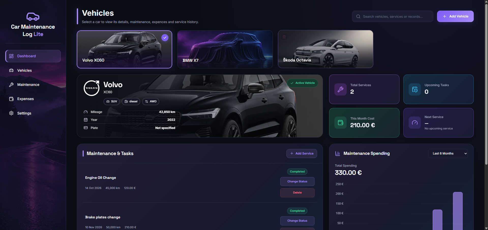

# 🚗 Car Maintenance Log Lite

A modern and responsive vehicle maintenance dashboard built with HTML, CSS, and Vanilla JavaScript.

Manage multiple vehicles, track service history, monitor maintenance expenses, and visualize mileage progress through a clean, interactive dashboard.

## 🌐 Live Demo

[View Live Demo]()

## 🖥️ Live Preview



## ✨ Features

- **Multi-Vehicle Management** – Add, select, search, and delete vehicles.
- **Vehicle Overview** – Display vehicle information, images, fuel type, and mileage.
- **Service Management** – Add and delete maintenance records.
- **Service Status Tracking** – Switch between Scheduled, Due Soon, and Completed.
- **Dashboard Statistics** – Track total services, upcoming tasks, and monthly maintenance costs.
- **Maintenance Spending Chart** – Visualize completed service expenses over the last 6 or 12 months using Chart.js.
- **Mileage Progress** – Monitor the progress toward the next scheduled service.
- **Live Search** – Filter vehicles by brand or model.
- **Local Storage** – Keep vehicle and maintenance data saved across page reloads.
- **Empty States** – Helpful messages when no vehicles or records are available.
- **Responsive UI** – Modern dark-themed interface with interactive vehicle cards and modal forms.

## 🛠️ Technologies Used

- HTML5
- CSS3
- JavaScript (ES6+)
- Chart.js
- Lucide Icons
- LocalStorage API

## 🧠 JavaScript Concepts

This project demonstrates practical use of:

- DOM manipulation and event delegation
- Arrays and objects
- Array methods: `find()`, `filter()`, `map()`, `reduce()`
- Form handling and input validation
- Dynamic HTML rendering
- Application state management
- JSON serialization and LocalStorage
- Date calculations and formatting
- Data visualization with Chart.js
- Responsive and interactive user interfaces

## 🚀 Getting Started

1. Clone the repository:

   ```bash
   git clone https://github.com/JohnyIsBackk/car-maintenance-log-lite.git
   ```

2. Open the project folder.

3. Launch `index.html` using a local development server, such as VS Code Live Server.

No framework, package installation, or build step is required.

## 📊 How It Works

1. Select an existing vehicle or add a new one.
2. View vehicle information and maintenance statistics.
3. Create service records with a date, cost, mileage, and status.
4. Update service statuses as maintenance progresses.
5. Explore maintenance expenses in the interactive chart.
6. Monitor mileage progress toward the next service.
7. Search for vehicles or remove records you no longer need.

Data is stored locally in your browser using LocalStorage.

## 🔒 Data Storage

This project is a frontend-only application.

Vehicle and maintenance data is stored in the browser's LocalStorage. No backend server or database is required.

Data is specific to the browser and device being used. Clearing browser storage may remove saved records.

## 👨‍💻 Author

**Samuel Jahn**

- Portfolio: https://samueljahn.sk
- GitHub: https://github.com/JohnyIsBackk
- Frontend CV: https://johnyisbackk.github.io/frontend-developer-cv/

## 📄 License

This project is licensed under the MIT License. See the [LICENSE](LICENSE) file for details.
